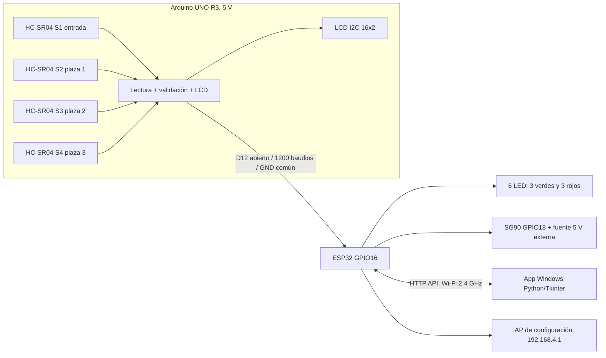

# Smart Parking V4

Prototipo de parqueo automático de tres plazas con Arduino UNO, ESP32 y un monitor de escritorio en Python. Cuatro sensores HC-SR04 miden la entrada y las plazas. La LCD y seis LED muestran disponibilidad, el ESP32 controla la pluma con un servomotor SG90 y el monitor recibe la telemetría por Wi-Fi.


## Qué permite hacer

- Detectar un vehículo en la entrada (**S1**) y determinar ocupación de **Plaza 1–3** con **S2–S4**.
- Encender **verde** cuando una plaza está libre y **rojo** cuando está ocupada. Ambos apagados cuando la lectura es inválida.
- Mostrar capacidad, ocupación y plazas libres en una **LCD I2C de 16×2**.
- Abrir la pluma si existe cupo, los datos son válidos y se detecta vehículo en la entrada; cerrar después de despejar la entrada y cumplir un retardo.
- Visualizar telemetría, historial, diagnósticos y logs desde la aplicación Windows (**Tkinter**, sin paquetes adicionales en tiempo de ejecución).
- Configurar desde la app un **Wi-Fi de 2.4 GHz**, usando el punto de acceso del propio ESP32 (`SmartParking-Setup`, IP `192.168.4.1`).
- Enviar órdenes autenticadas `ping`, prueba de LED y solicitudes de apertura/cierre con confirmación **lógica**, no física.
- Actualizar el firmware del ESP32 mediante **ArduinoOTA** desde Arduino IDE cuando el equipo está accesible por la red.

## Arquitectura



### Imágenes y planos

- [Diagrama eléctrico general](diagramas/01_Diagrama_General.png) · [SVG editable](diagramas/01_Diagrama_General.svg)
- [Conexión de los seis LED y resistencias](diagramas/02_Detalle_LEDs.png) · [SVG editable](diagramas/02_Detalle_LEDs.svg)
- [Distribución sugerida de la maqueta](diagramas/03_Plano_Maqueta.png) · [SVG editable](diagramas/03_Plano_Maqueta.svg)

## Materiales principales

| Cantidad | Componente | Uso |
|---:|---|---|
| 1 | Arduino UNO R3 | Sensores y LCD |
| 1 | ESP32-WROOM-32 DevKit | Control, LED, Wi-Fi y API |
| 4 | HC-SR04 | Entrada y 3 plazas |
| 1 | LCD 16×2 con PCF8574 I2C | Contador local |
| 1 | Microservo SG90 | Barrera |
| 3 + 3 | LED verdes y rojos | Disponibilidad |
| 6 | Resistencias **330 Ω**, ¼ W | Limitación de corriente de cada LED |
| 1 | Resistencia **4.7 kΩ** | Pull-up a **3V3** de ESP32 GPIO16 |
| 1 | Fuente **5 V regulada**, recomendable ≥2 A | Alimentación independiente del servo |
| Varias | Protoboard, Dupont, cables, maqueta | Montaje |

**Resumen de conexiones:** S1 D4/D5; S2 D6/D7; S3 D8/D9; S4 D10/D11 en el UNO. LCD SDA A4, SCL A5. UNO D12 → ESP32 GPIO16; GPIO16 con pull-up de 4.7 kΩ a **3V3**. Servo señal en GPIO18. LED verdes GPIO25/27/33; rojos GPIO26/32/23, con una resistencia de 330 Ω **por LED** y cátodos a GND. **Todas las tierras conectadas.** Consulta el plano y [guía completa de cableado](documentacion/02_HARDWARE_Y_CABLEADO.md).

## Instalación rápida

### 1. Arduino UNO

1. Instala [Arduino IDE](https://www.arduino.cc/en/software) y la biblioteca **hd44780** de Bill Perry (Library Manager).
2. Abre `firmware/arduino_uno/Parqueo_UNO_4_Sensores/Parqueo_UNO_4_Sensores.ino`.
3. Selecciona **Arduino Uno** y su puerto USB. Carga. Monitor serie a **9600**.
4. Comprueba tramas `S1:...,S2:...,S3:...,S4:...` (valores en **milímetros**; `-1` significa sin lectura).

### 2. ESP32

1. Instala el paquete de placas **esp32 by Espressif Systems** y la biblioteca **ESP32Servo** (el sketch también usa `WiFi`, `WebServer`, `Preferences` y `ArduinoOTA` del core ESP32).
2. En `firmware/esp32/Parqueo_ESP32_WiFi_Config/`, **copia** `config_private.example.h` como `config_private.h` y reemplaza las tres claves de ejemplo. `config_private.h` está excluido de Git.
3. Abre el `.ino` ESP32 de esa carpeta y selecciona **ESP32 Dev Module** y el puerto USB correspondiente. Instálalo. Monitor serie a **115200**.
4. Verifica la red **SmartParking-Setup** y prueba, conectado a ella, [http://192.168.4.1/api/estado](http://192.168.4.1/api/estado).

Configura `SP_AP_PASSWORD` con entre 8 y 63 caracteres ASCII. Antes de conectar el monitor, verifica que `SmartParking-Setup` aparezca como red protegida. Conecta el GPIO16 del ESP32 según la [guía de cableado](documentacion/02_HARDWARE_Y_CABLEADO.md).

### 3. Monitor Windows

- **Ejecutable para Windows:** abre `SmartParkingMonitorV4.exe` desde la raíz.
- **Código fuente:** instala Python 3.10 o superior con Tcl/Tk. Desde `aplicacion/`, abre `ABRIR_MONITOR.cmd` o ejecuta `py -3 monitor_parqueo.py`.
- **Modo demostración:** abre `ABRIR_DEMO.cmd` o ejecuta `py -3 monitor_parqueo.py --demo` desde `aplicacion/`.
- **Conexión al ESP32:** conecta la PC a `SmartParking-Setup`, selecciona `192.168.4.1` y usa **Configurar red Wi-Fi** para configurar el hotspot. Luego conecta la PC a esa misma red y usa la IP asignada al ESP32.

## Librerías de Python

El monitor usa la biblioteca estándar de Python. Para ejecutarlo desde el código fuente se requiere una instalación con **Tkinter y Tcl/Tk**. Las pruebas también usan módulos estándar. **PyInstaller 6.x** es la única dependencia externa directa y se instala al generar el ejecutable.

| Área | Módulos principales | Para qué se usan |
|---|---|---|
| Interfaz | `tkinter`, `tkinter.ttk` | Mostrar el panel, los formularios y las gráficas. |
| Comunicación | `urllib`, `json`, `socket`, `ipaddress` | Consultar el ESP32, validar sus respuestas y descubrirlo en la red local. |
| Concurrencia | `threading`, `queue`, `concurrent.futures` | Procesar las consultas en segundo plano y actualizar la interfaz. |
| Historial y ajustes | `collections`, `csv`, `datetime`, `pathlib` | Guardar muestras en memoria, exportarlas y recuperar la última dirección del ESP32. |
| Pruebas y ejecutable | `unittest`, `http.server`, `PyInstaller` | Probar el monitor con una API simulada y empaquetar la aplicación para Windows. |

La [documentación de Python](documentacion/04_APLICACION_PYTHON.md) detalla **cada módulo importado**, su propósito, los comandos para ejecutar las pruebas y cómo generar el ejecutable.

Guías de [firmware](documentacion/03_FIRMWARE.md) y [red, API y OTA](documentacion/05_RED_WIFI_API_OTA.md).

## Carpetas

```text
Smart Parking V4/
├── README.md, LEEME.txt, SmartParkingMonitorV4.exe, .gitignore
├── firmware/
│   ├── arduino_uno/Parqueo_UNO_4_Sensores/*.ino
│   └── esp32/Parqueo_ESP32_WiFi_Config/
│       ├── Parqueo_ESP32_WiFi_Config.ino
│       └── config_private.example.h
├── aplicacion/
│   ├── monitor_parqueo.py
│   ├── PRUEBAS.py, PRUEBAS_RED.py
│   └── *.cmd
├── diagramas/                  # PNG + SVG
├── capturas/                   # Pantallas de modo demostración
├── documentacion/              # Guías y ejemplo de API
├── herramientas/               # Verificaciones de pinout/secretos
└── .github/workflows/          # Pruebas de Python en CI
```

## Pruebas

Desde la raíz del proyecto en PowerShell:

```powershell
py -3 aplicacion/PRUEBAS.py
py -3 aplicacion/PRUEBAS_RED.py
py -3 herramientas/validar_repositorio.py
```

Las **26 pruebas automatizadas** cubren el monitor (17) y la comunicación con una API simulada (9). El validador comprueba el pinout, las interfaces compartidas y la exclusión del archivo privado. La [matriz de pruebas](documentacion/06_PRUEBAS_Y_DIAGNOSTICO.md) incluye las comprobaciones de la maqueta.

## Límites importantes

Usa el sistema como maqueta supervisada. El monitor muestra el estado lógico de los LED y la posición ordenada al servo. Opera la API HTTP en una red Wi-Fi local protegida y guarda las credenciales en `config_private.h`. Consulta [seguridad y limitaciones](documentacion/07_SEGURIDAD_Y_LIMITACIONES.md).
