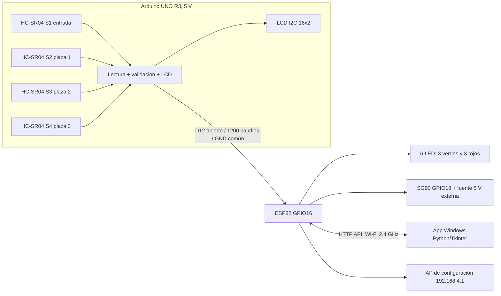

# Smart Parking — Parqueo automático de 3 plazas

**Proyecto académico de automatización, electrónica y desarrollo de software** con Arduino UNO, ESP32 y una aplicación de escritorio Python. El sistema detecta vehículos mediante cuatro sensores HC-SR04, informa disponibilidad de tres plazas mediante seis LED y una pantalla LCD, controla una pluma con servomotor SG90 y envía telemetría a una interfaz Windows por Wi-Fi.

> **Estado del proyecto (noviembre de 2026).** En la maqueta se comprobó en vivo la comunicación UNO–ESP32 y la consulta HTTP desde Python: el monitor mostró 3 plazas libres, los 4 sensores y la orden de apertura de la pluma. **No se ha certificado el funcionamiento físico continuo ni un control de tránsito vehicular real.** Las 26 pruebas automatizadas son de Python y API simulada. La versión del código de GitHub separa las claves en `config_private.h`; esa reorganización debe compilarse y cargarse de nuevo si se quiere instalar a partir de este repositorio.


## Qué permite hacer

- Detectar un vehículo en la entrada (**S1**) y determinar ocupación de **Plaza 1–3** con **S2–S4**.
- Encender **verde** cuando una plaza está libre y **rojo** cuando está ocupada. Ambos apagados cuando la lectura es inválida.
- Mostrar capacidad, ocupación y plazas libres en una **LCD I2C de 16×2**.
- Abrir la pluma si existe cupo, los datos son válidos y se detecta vehículo en la entrada; cerrar después de despejar la entrada y cumplir un retardo.
- Visualizar telemetría, historial, diagnósticos y logs desde la aplicación Windows (**Tkinter**, sin paquetes adicionales en tiempo de ejecución).
- Configurar desde la app un **Wi-Fi de 2.4 GHz**, usando el punto de acceso del propio ESP32 (`SmartParking-Setup`, IP `192.168.4.1`).
- Enviar órdenes autenticadas `ping`, prueba de LED y solicitudes de apertura/cierre con confirmación **lógica**, no física.
- Actualizar el firmware del ESP32 mediante **ArduinoOTA** desde Arduino IDE cuando el equipo está accesible por la red.

## Arquitectura



### Imágenes y planos

- [Diagrama eléctrico general](diagramas/01_Diagrama_General.png) · [SVG editable](diagramas/01_Diagrama_General.svg)
- [Conexión de los seis LED y resistencias](diagramas/02_Detalle_LEDs.png) · [SVG editable](diagramas/02_Detalle_LEDs.svg)
- [Distribución sugerida de la maqueta](diagramas/03_Plano_Maqueta.png) · [SVG editable](diagramas/03_Plano_Maqueta.svg)

## Materiales principales

| Cantidad | Componente | Uso |
|---:|---|---|
| 1 | Arduino UNO R3 | Sensores y LCD |
| 1 | ESP32-WROOM-32 DevKit | Control, LED, Wi-Fi y API |
| 4 | HC-SR04 | Entrada y 3 plazas |
| 1 | LCD 16×2 con PCF8574 I2C | Contador local |
| 1 | Microservo SG90 | Barrera |
| 3 + 3 | LED verdes y rojos | Disponibilidad |
| 6 | Resistencias **330 Ω**, ¼ W | Limitación de corriente de cada LED |
| 1 | Resistencia **4.7 kΩ** | Pull-up a **3V3** de ESP32 GPIO16 |
| 1 | Fuente **5 V regulada**, recomendable ≥2 A | Alimentación independiente del servo |
| Varias | Protoboard, Dupont, cables, maqueta | Montaje |

**Resumen de conexiones:** S1 D4/D5; S2 D6/D7; S3 D8/D9; S4 D10/D11 en el UNO. LCD SDA A4, SCL A5. UNO D12 → ESP32 GPIO16; GPIO16 con pull-up de 4.7 kΩ a **3V3**. Servo señal en GPIO18. LED verdes GPIO25/27/33; rojos GPIO26/32/23, con una resistencia de 330 Ω **por LED** y cátodos a GND. **Todas las tierras conectadas.** Consulta el plano y [guía completa de cableado](documentacion/02_HARDWARE_Y_CABLEADO.md).

## Instalación rápida

### 1. Arduino UNO

1. Instala [Arduino IDE](https://www.arduino.cc/en/software) y la biblioteca **hd44780** de Bill Perry (Library Manager).
2. Abre `firmware/arduino_uno/Parqueo_UNO_4_Sensores/Parqueo_UNO_4_Sensores.ino`.
3. Selecciona **Arduino Uno** y su puerto USB. Carga. Monitor serie a **9600**.
4. Comprueba tramas `S1:...,S2:...,S3:...,S4:...` (valores en **milímetros**; `-1` significa sin lectura).

### 2. ESP32

1. Instala el paquete de placas **esp32 by Espressif Systems** y la biblioteca **ESP32Servo** (el sketch también usa `WiFi`, `WebServer`, `Preferences` y `ArduinoOTA` del core ESP32).
2. En `firmware/esp32/Parqueo_ESP32_WiFi_Config/`, **copia** `config_private.example.h` como `config_private.h` y reemplaza las tres claves de ejemplo. `config_private.h` está excluido de Git.
3. Abre el `.ino` ESP32 de esa carpeta y selecciona **ESP32 Dev Module** y el puerto USB correspondiente. Instálalo. Monitor serie a **115200**.
4. Verifica la red **SmartParking-Setup** y prueba, conectado a ella, [http://192.168.4.1/api/estado](http://192.168.4.1/api/estado).

**Seguridad:** no uses claves de siete caracteres; WPA2 exige **8–63**. Si el AP aparece «abierto», revisa `SP_AP_PASSWORD` y vuelve a cargar el firmware. Nunca conectes 5 V directamente a GPIO16/otros GPIO del ESP32. Al subir el UNO, puedes desconectar D12→GPIO16 temporalmente.

### 3. Monitor Windows

- Instala **Python 3.10 o superior** con soporte Tkinter.
- Desde `aplicacion/`, haz doble clic en `ABRIR_MONITOR.cmd`, o ejecuta `py -3 monitor_parqueo.py`.
- **Demo sin hardware:** `py -3 monitor_parqueo.py --demo` o `ABRIR_DEMO.cmd`.
- **Generar EXE en Windows:** `CREAR_EJECUTABLE.cmd` (instala PyInstaller y genera `SmartParkingMonitorV4.exe`). La raíz del proyecto incluye `SmartParkingMonitorV4.exe`, listo para abrir en Windows.
- Conecta la PC al AP del ESP32, selecciona `192.168.4.1`, luego **Configurar red Wi-Fi** para guardar el hotspot y obtener la nueva IP.

Documentación detallada: [firmware](documentacion/03_FIRMWARE.md) · [Python](documentacion/04_APLICACION_PYTHON.md) · [red, API y OTA](documentacion/05_RED_WIFI_API_OTA.md).

## Carpetas

```text
Repositorio/
├── README.md, LEEME.txt, SmartParkingMonitorV4.exe, .gitignore
├── firmware/
│   ├── arduino_uno/Parqueo_UNO_4_Sensores/*.ino
│   └── esp32/Parqueo_ESP32_WiFi_Config/
│       ├── Parqueo_ESP32_WiFi_Config.ino
│       └── config_private.example.h
├── aplicacion/
│   ├── monitor_parqueo.py
│   ├── PRUEBAS.py, PRUEBAS_RED.py
│   └── *.cmd
├── diagramas/                  # PNG + SVG
├── capturas/                   # Pantallas de modo demostración
├── documentacion/              # 9 guías y ejemplo de API
├── herramientas/               # Verificaciones de pinout/secretos
└── .github/workflows/          # Pruebas de Python en CI
```

## Pruebas

Desde `aplicacion/`:

```bash
python PRUEBAS.py
python PRUEBAS_RED.py
```

Se verificaron **26 tests automatizados** (17 del monitor y 9 de red) y sintaxis Python. La comprobación de pinout/secretos se ejecuta con `python herramientas/validar_repositorio.py`. Las pruebas son con **API simulada**, no sustituyen una prueba de laboratorio ni el compilador de Arduino en tu equipo. Ver [matriz de pruebas](documentacion/06_PRUEBAS_Y_DIAGNOSTICO.md).

## Límites importantes

> **Prototipo didáctico, no dispositivo de seguridad para tráfico real.** Una sola medición en la entrada y una posición de servo ordenada no garantizan que el recorrido esté libre; la maqueta no incluye barrera fotoeléctrica, detección redundante ni finales de carrera. No dejar la pluma sin supervisión. El LED y estado de pluma mostrados en Python reflejan lógica/órdenes del ESP32, **no realimentación física independiente**. Las credenciales Wi-Fi y el token se transmiten vía HTTP sobre una LAN/AP local protegida, por lo que no debe utilizarse en redes públicas.

La carpeta **no contiene contraseñas reales ni registros personales**. Si ya revelaste una contraseña anteriormente en capturas o conversaciones, considera cambiarla antes de la exposición y antes de publicar.

## Publicación en GitHub

Consulta [la guía de publicación](documentacion/09_GIT_Y_GITHUB.md) para preparar un commit con todo el proyecto.
