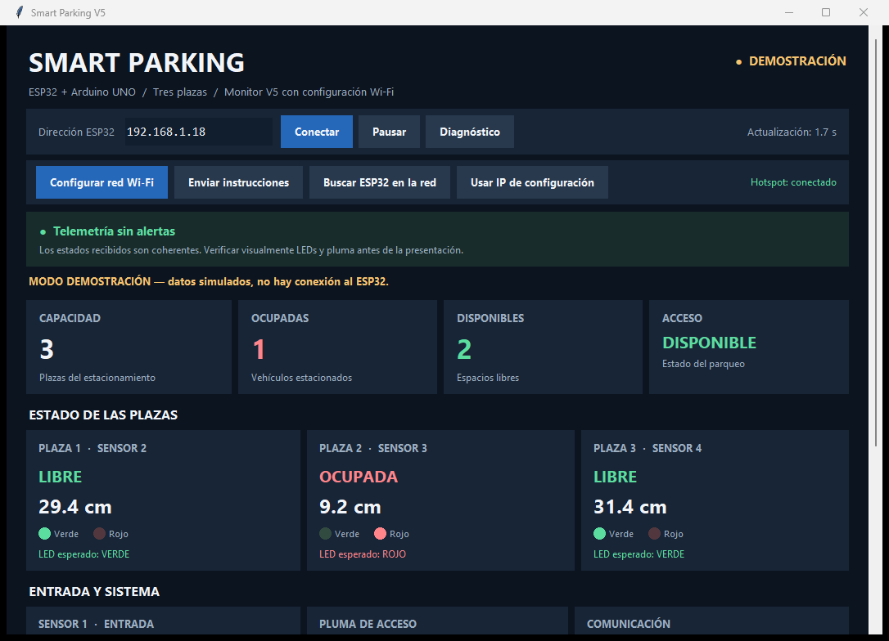

# Smart Parking V5

Prototipo de estacionamiento automático de tres plazas. Un Arduino UNO lee cuatro sensores ultrasónicos y actualiza la LCD. El ESP32 controla la pluma y los LED. Una aplicación de escritorio en Python muestra por Wi-Fi la ocupación, las distancias y el registro de eventos.

## Integrantes

| Nombre | Carnet |
|---|---|
| Angel Gabriel Salmeron Funes | SMSS040421 |
| Brenda Janeth Villalta Torres | SMSS062425 |
| Jimena Damari Cañas Guevara | SMSS155224 |
| Heidy Carolina Galeano Vásquez | SMSS147324 |

## Segundo avance

- El sensor de entrada confirma la presencia de un vehículo tras dos lecturas consecutivas a **5 cm o menos**.
- La pluma se abre cuando el UNO está conectado, las tres plazas tienen datos válidos y al menos una está libre.
- El cierre automático requiere dos lecturas a **7 cm o más** y **3 segundos** con la entrada despejada. El temporizador se reinicia si se pierde la confirmación de despeje.
- El panel muestra el estado de los sensores, la pluma, los LED esperados y la comunicación con el UNO. También ofrece historial, diagnóstico y exportaciones.
- El ESP32 permite configurar el Wi-Fi de 2,4 GHz desde su punto de acceso. El monitor puede enviar instrucciones autenticadas y el firmware admite actualizaciones OTA desde Arduino IDE.

[Informe PDF del segundo avance](documentacion/Segundo_Avance_Smart_Parking_V5.pdf) · [Capturas de la V5](capturas/) · [Diagrama general](diagramas/01_Diagrama_General.png)



## Versiones y dependencias

| Entorno | Versión de referencia | Uso |
|---|---|---|
| Python | 3.10 o superior, pruebas locales con 3.12.14 | Ejecutar el monitor y las pruebas. |
| Tcl/Tk y módulo `tkinter` | Tcl/Tk 8.6, incluido en la instalación gráfica de Python | Panel, formularios y gráficas. |
| `urllib`, `json`, `socket` e `ipaddress` | Biblioteca estándar de la versión de Python instalada | Consultas HTTP al ESP32, lectura de respuestas y búsqueda en la red local. |
| `threading`, `queue` y `concurrent.futures` | Biblioteca estándar de Python | Consultas en segundo plano y entrega de datos a la interfaz. |
| `collections`, `csv`, `datetime` y `pathlib` | Biblioteca estándar de Python | Historial, exportaciones y configuración local. |
| `unittest` y `http.server` | Biblioteca estándar de Python | Pruebas del monitor contra una API simulada. |
| PyInstaller | 6.16.0 | Dependencia opcional para generar el ejecutable en Windows. |
| Arduino AVR Boards | 1.8.8 | Compilar el firmware del Arduino UNO. Incluye `Wire` para I2C. |
| hd44780, de Bill Perry | 1.3.2 | Manejar la pantalla LCD I2C de 16×2. |
| esp32 by Espressif Systems | 3.3.12 | Compilar el firmware del ESP32. Incluye `WiFi`, `WebServer`, `Preferences` y `ArduinoOTA`. |
| ESP32Servo | 3.2.1 | Controlar la posición del servomotor SG90. |

[requirements.txt](requirements.txt) registra que el monitor solo usa módulos estándar. [requirements-dev.txt](requirements-dev.txt) fija la versión de PyInstaller. La [guía de Python](documentacion/04_APLICACION_PYTHON.md) explica cada módulo.

## Instalación

En Windows puedes abrir [SmartParkingMonitorV5.exe](SmartParkingMonitorV5.exe) desde la raíz del repositorio. Si quieres ejecutar el código fuente o probar el modo demostración, sigue el paso 1.

### 1. Clonar el repositorio y abrir el monitor

Desde PowerShell, con Git y una instalación de Python que incluya Tcl/Tk:

```powershell
git clone https://github.com/ZapSalm/PROYECTOFINALPYTHON.git
cd PROYECTOFINALPYTHON
py -3 -m pip install -r requirements.txt
py -3 aplicacion/monitor_parqueo.py --demo
```

La demostración muestra datos simulados. Para monitorear la maqueta, ejecuta `py -3 aplicacion/monitor_parqueo.py` y usa la IP del ESP32. Si prefieres generar un ejecutable V5, ejecuta `aplicacion/CREAR_EJECUTABLE.cmd` en Windows.

### 2. Cargar el Arduino UNO

1. Instala [Arduino IDE](https://www.arduino.cc/en/software). En el gestor de placas selecciona **Arduino AVR Boards 1.8.8** y en el gestor de bibliotecas instala **hd44780 1.3.2**.
2. Abre [el sketch del UNO](firmware/arduino_uno/Parqueo_UNO_4_Sensores/Parqueo_UNO_4_Sensores.ino). Elige **Arduino Uno**, selecciona su puerto USB y carga el código.
3. Abre el monitor serie a **9600 baudios**. Una trama correcta tiene el formato `S1:...,S2:...,S3:...,S4:...` en milímetros. Un `-1` indica una lectura inválida.

### 3. Cargar el ESP32

1. En el gestor de placas instala **esp32 by Espressif Systems 3.3.12**. En el gestor de bibliotecas instala **ESP32Servo 3.2.1**.
2. En [la carpeta del ESP32](firmware/esp32/Parqueo_ESP32_WiFi_Config/), copia `config_private.example.h` como `config_private.h` y asigna claves propias a `SP_AP_PASSWORD`, `SP_CONTROL_TOKEN` y `SP_OTA_PASSWORD`. Usa entre 8 y 63 caracteres ASCII para la clave del punto de acceso. Conserva este archivo exclusivamente en tu equipo.
3. Abre `Parqueo_ESP32_WiFi_Config.ino`, selecciona **ESP32 Dev Module** y el puerto USB y carga el código. Usa **115200 baudios** para el monitor serie.
4. Conecta la computadora a **SmartParking-Setup** y abre [el estado del dispositivo](http://192.168.4.1/api/estado). En el monitor usa `192.168.4.1` y pulsa **Conectar**. Para usar otra red de 2,4 GHz, pulsa **Configurar red Wi-Fi**. Conecta ambos equipos a esa red y usa en la app la IP asignada al ESP32.

### 4. Montar la maqueta

Consulta la [guía de cableado](documentacion/02_HARDWARE_Y_CABLEADO.md), el [diagrama eléctrico](diagramas/01_Diagrama_General.png), el [detalle de los LED](diagramas/02_Detalle_LEDs.png) y el [plano de distribución](diagramas/03_Plano_Maqueta.png).

| Elemento | Conexión principal |
|---|---|
| Sensores S1–S4 | Arduino UNO. TRIG/ECHO D4/D5, D6/D7, D8/D9 y D10/D11. |
| Pantalla LCD | SDA A4 y SCL A5 del Arduino UNO. |
| Comunicación entre placas | UNO D12 en salida abierta a ESP32 GPIO16, a 1200 baudios y con tierra común. Consulta el acondicionamiento de señal en la guía de cableado. |
| Servomotor SG90 | Señal ESP32 GPIO18, fuente de 5 V regulada independiente y tierra común. |
| LED por plaza | Verdes GPIO25, GPIO27 y GPIO33. Rojos GPIO26, GPIO32 y GPIO23. |

El sistema conserva las muestras del monitor en memoria durante cada sesión y permite guardarlas en CSV. La configuración local del monitor se guarda en JSON. El proyecto funciona sin un motor de base de datos.

## Pruebas y documentación

```powershell
py -3 aplicacion/PRUEBAS.py
py -3 aplicacion/PRUEBAS_RED.py
py -3 herramientas/validar_repositorio.py
```

Las pruebas de Python verifican el monitor y la comunicación HTTP simulada. El validador verifica pines, umbrales, rutas de la API y configuración privada. Para comprobar el movimiento físico del servo y las lecturas en la maqueta, sigue la [matriz de pruebas](documentacion/06_PRUEBAS_Y_DIAGNOSTICO.md).

- [Arquitectura](documentacion/01_ARQUITECTURA.md) y [firmware](documentacion/03_FIRMWARE.md).
- [Red, API y OTA](documentacion/05_RED_WIFI_API_OTA.md).
- [Seguridad y limitaciones](documentacion/07_SEGURIDAD_Y_LIMITACIONES.md).
