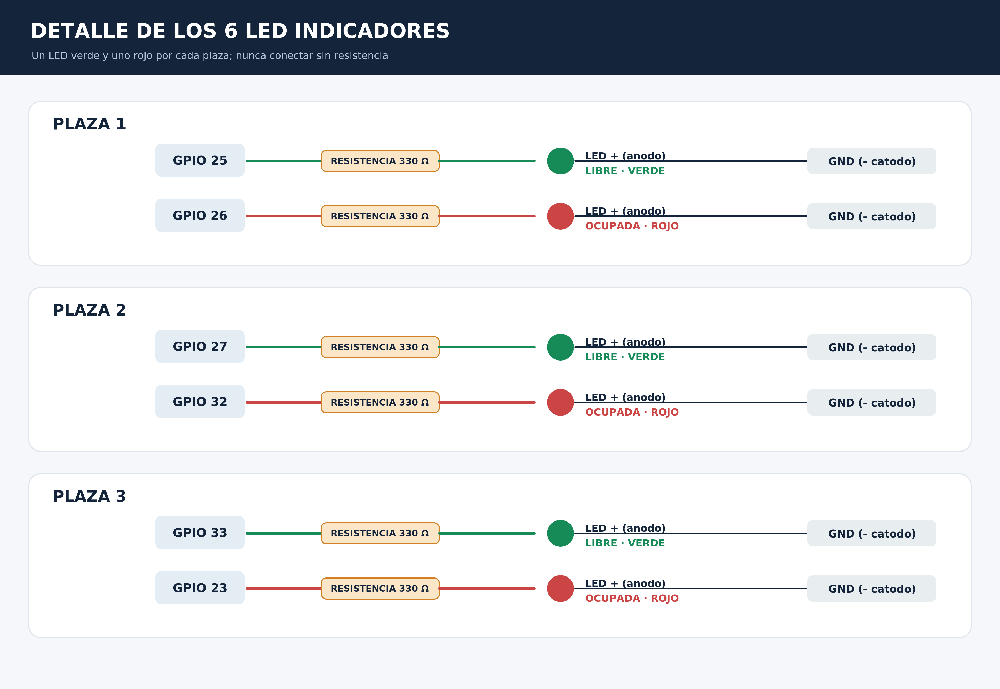
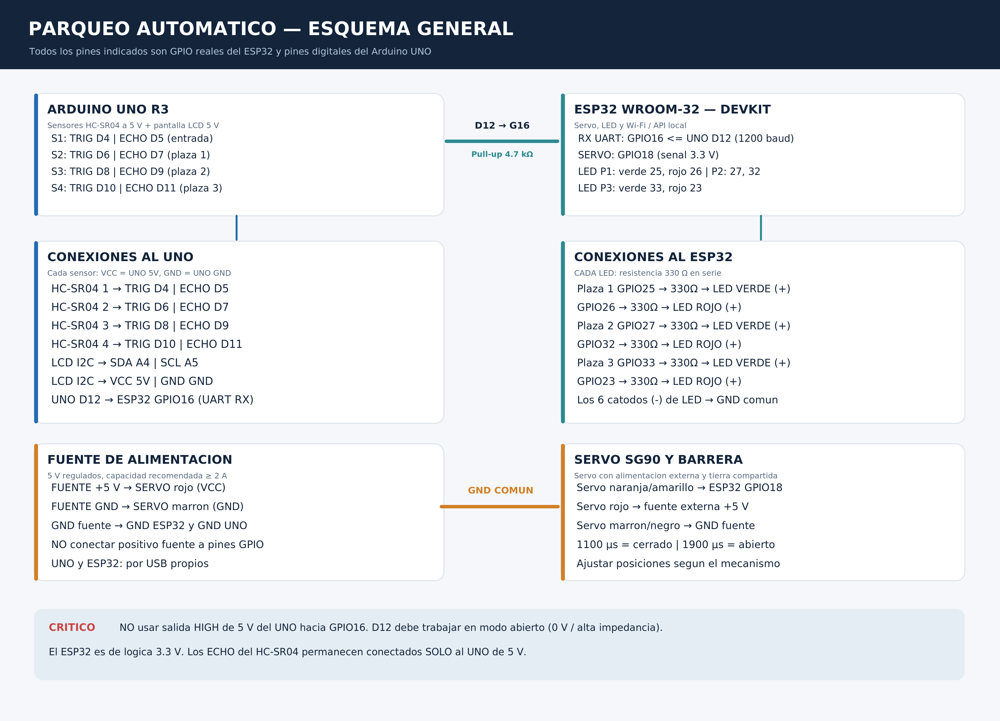
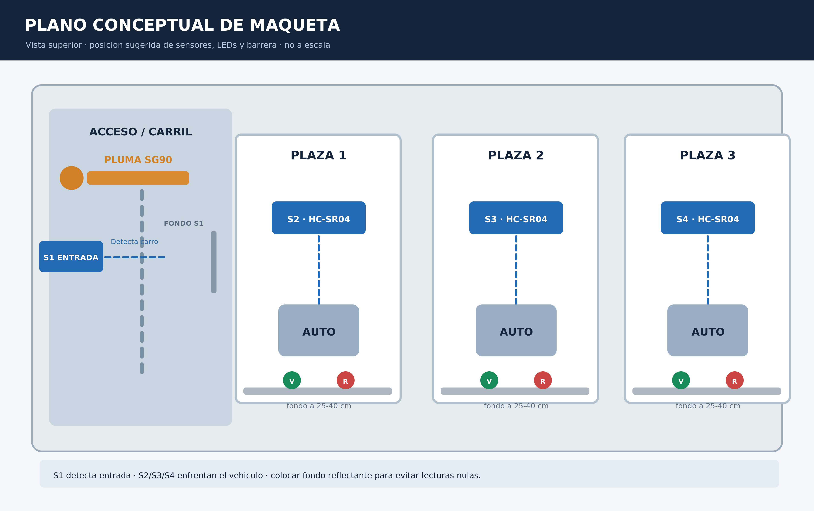

# 02 — Componentes, conexiones y montaje

## Listado de módulos

| Módulo | Alimentación | Biblioteca o controlador | Función |
|---|---|---|---|
| Arduino UNO R3 | USB / 5 V | Arduino AVR Core | Adquisición de sensores, LCD y TX abierto |
| ESP32-WROOM-32 DevKit | USB para la placa; GPIO a 3.3 V | esp32 by Espressif | Wi-Fi, API, LED y servo |
| 4 × HC-SR04 | **5 V del UNO** | `pulseIn` | Medición de presencia por distancia |
| LCD 16×2 + módulo PCF8574 | **5 V del UNO** | `Wire`, `hd44780` | Disponibilidad local |
| Microservo SG90 | **5 V externa regulada** | `ESP32Servo` | Barrera motorizada |
| 3 LED verdes / 3 rojos | GPIO ESP32 a través de resistencia | `digitalWrite` | Disponibilidad por plaza |
| 6 × resistencias 330 Ω | Una en serie por LED | — | Limitar corriente |
| 1 × resistencia 4.7 kΩ | **3V3 → GPIO16 ESP32** | — | Pull-up de UART abierto |
| Fuente 5 V, ≥2 A recomendada | Servo | — | Evitar caída de tensión |

## Tabla de pines — Arduino UNO

| Sensor | Ubicación | TRIG | ECHO | VCC | GND |
|---|---|---|---|---|---|
| S1 | Entrada | D4 | D5 | 5 V | GND UNO |
| S2 | Plaza 1 | D6 | D7 | 5 V | GND UNO |
| S3 | Plaza 2 | D8 | D9 | 5 V | GND UNO |
| S4 | Plaza 3 | D10 | D11 | 5 V | GND UNO |

LCD: `SDA → A4`, `SCL → A5`, `VCC → 5V`, `GND → GND`. Comunicación: `D12 → ESP32 GPIO16` con GND común y pull-up receptor de **4.7 kΩ a 3V3**.

## Tabla de pines — ESP32

| GPIO | Conexión física | Observación |
|---|---|---|
| GPIO16 | UNO D12 | UART RX, 1200 bps, salida abierta del UNO |
| GPIO18 | Cable naranja/amarillo SG90 | PWM 50 Hz, NO alimentación del servo |
| GPIO25 | Resistencia 330 Ω → ánodo LED verde P1 | Cátodo a GND |
| GPIO26 | Resistencia 330 Ω → ánodo LED rojo P1 | Cátodo a GND |
| GPIO27 | Resistencia 330 Ω → ánodo LED verde P2 | Cátodo a GND |
| GPIO32 | Resistencia 330 Ω → ánodo LED rojo P2 | Cátodo a GND |
| GPIO33 | Resistencia 330 Ω → ánodo LED verde P3 | Cátodo a GND |
| GPIO23 | Resistencia 330 Ω → ánodo LED rojo P3 | Cátodo a GND |
| 3V3 | Resistencia 4.7 kΩ → GPIO16 | Pull-up receptor, **no 5 V** |
| GND | GND de UNO y de fuente de servo | Tierra común |

**Servo SG90:** señal naranja a GPIO18, VCC rojo a +5 V regulados externos, GND marrón/negro a GND de esa fuente. Unir GND fuente, GND ESP32 y GND UNO. **No unir positivos de dos fuentes USB diferentes** salvo diseño de alimentación específico.

## Diagrama de LED

```text
ESP32 GPIO25 -- 330Ω -- (+) LED verde P1 (-) -- GND
ESP32 GPIO26 -- 330Ω -- (+) LED rojo  P1 (-) -- GND
ESP32 GPIO27 -- 330Ω -- (+) LED verde P2 (-) -- GND
ESP32 GPIO32 -- 330Ω -- (+) LED rojo  P2 (-) -- GND
ESP32 GPIO33 -- 330Ω -- (+) LED verde P3 (-) -- GND
ESP32 GPIO23 -- 330Ω -- (+) LED rojo  P3 (-) -- GND
```

Cada LED usa su resistencia; **ninguno comparte resistencia**. Una pata corta o lado plano del LED normalmente identifica el cátodo (-).





## Montaje seguro y calibración

1. Con todas las placas apagadas, coloca componentes y verifica que las líneas positivas no estén cortocircuitadas a GND.
2. Alimenta UNO y ESP32 mediante sus conexiones USB; servo por fuente 5 V independiente.
3. Conecta GND común **antes** de conectar señales entre placas.
4. Asegúrate de que los `ECHO` de 5 V llegan únicamente al UNO; nunca directamente al ESP32.
5. Los cuatro sensores deben apuntar a una superficie donde devuelvan eco válido aun estando libre la plaza. Recomendada maqueta con plano de referencia fijo y distancia vacía definida.
6. Ajusta la posición del servo **sin el brazo de la barrera montado** y luego instala el mecanismo una vez conocidos sus límites.
7. Usa resistencias individuales de 330 Ω, tira suavemente de cada conexión y evita unir ambas patas de un LED en la misma línea de una protoboard.
8. Para pruebas de subida del sketch UNO, desconecta temporalmente D12↔GPIO16; vuelve a conectarlo con placas apagadas.

## Distribución orientativa



El plano propone disposición, no medidas obligatorias del modelo. No interpretes el montaje como sistema seguro de barrera real; falta sensor independiente debajo de la pluma y detección de tránsito que confirme paso del vehículo.
