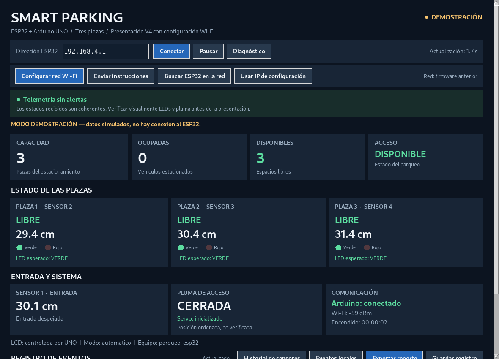
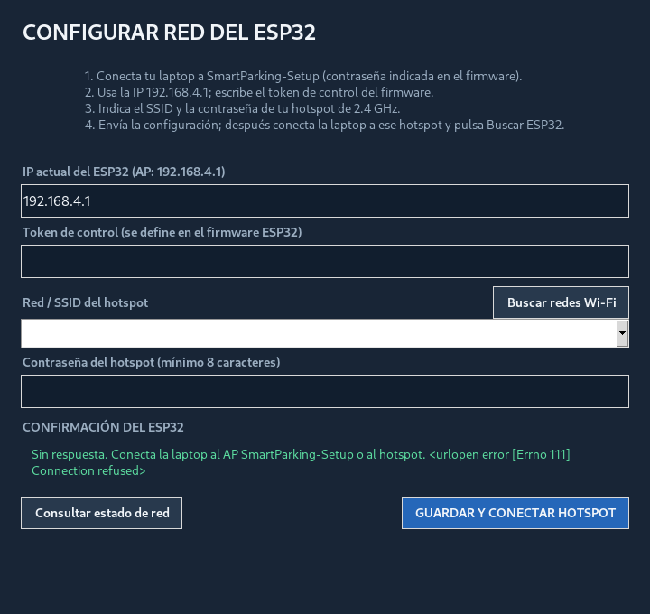
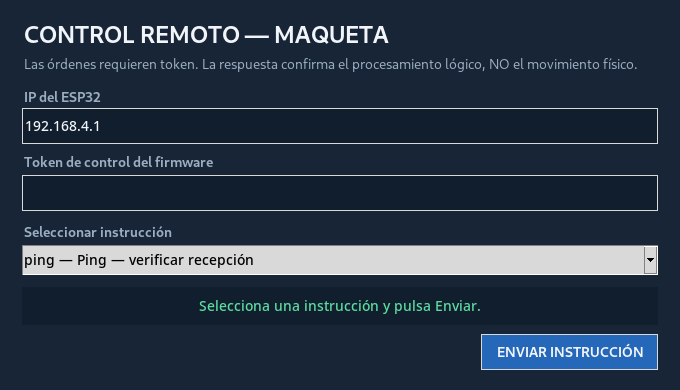

# 04 — Aplicación de escritorio Python

## Tecnologías utilizadas

- **Python 3.10+**.
- **Tkinter / ttk**: ventana, tarjetas de información, formularios, acciones y gráficos integrados.
- **urllib.request / urllib.parse / urllib.error**: HTTP GET/POST a los endpoints del ESP32, sin cliente externo.
- **json**: parseo y validación de telemetría.
- **socket / ipaddress / concurrent.futures**: identificación y búsqueda local del ESP32 en una subred `/24`.
- **threading / queue**: consultas sin bloquear la interfaz gráfica.
- **collections.deque**: historial acotado de lecturas.
- **csv**: exportación de mediciones compatibles con Excel.
- **datetime / time**: marcas temporales, tiempo encendido y refresco.
- **pathlib / os**: archivo local con última dirección del ESP32.
- **uuid**: identificador de correlación de cada instrucción.
- **argparse**: opción `--demo`.
- **PyInstaller**: **opcional**, solo para crear `.exe` Windows.

No hace falta instalar `requests`, Flask, PyQt ni bases de datos para ejecutar este monitor.

## Pantallas







- **Resumen**: capacidad 3, ocupadas, disponibles, acceso.
- **Tres plazas**: distancia, estado libre/ocupado/desconocido, LED lógicos.
- **Entrada y sistema**: S1, pluma, Arduino UNO, señal RSSI y uptime.
- **Conectividad**: dirección actual, `192.168.4.1`, búsqueda del ESP32.
- **Wi-Fi**: escanear SSID, registrar contraseña del hotspot, guardar y consultar estado STA.
- **Órdenes**: `ping`, test de LED y apertura/cierre sujetos a validación del ESP32.
- **Herramientas**: eventos, diagnósticos TXT, historial CSV y modo demostración.

## Inicio

Abre un terminal en `aplicacion/`:

```powershell
py -3 monitor_parqueo.py
```

Modo sin hardware:

```powershell
py -3 monitor_parqueo.py --demo
```

También están disponibles `ABRIR_MONITOR.cmd` y `ABRIR_DEMO.cmd` para Windows. Si usas Python de Microsoft Store, verifica que tenga el módulo `tkinter`; las instalaciones estándar de python.org suelen incluirlo.

## Crear programa EXE

En Windows, ejecutar `CREAR_EJECUTABLE.cmd`: instala PyInstaller y empaqueta el monitor como `SmartParkingMonitorV4.exe`, luego intenta copiar el ejecutable al Escritorio. Necesita Internet si PyInstaller no está instalado. **Un ejecutable para Windows no puede considerarse construido hasta ejecutar ese script en Windows**.

## Tratamiento de fallos

- `null` en distancia y ocupación = desconocido, **jamás libre**.
- Si falla UNO, se ocultan mediciones y conteos obsoletos.
- Si falla HTTP, UI indica desconexión y reintenta.
- Si `/api/logs` falla pero `/api/estado` funciona, conserva telemetría con aviso específico.
- Cambio de Wi-Fi: primero se recibe la configuración (`202 Accepted`), luego se consulta `/api/wifi/status` para confirmar asociación real e IP asignada.
- La única preferencia guardada por la app es la última IP/hostname (Windows: `%APPDATA%/SmartParkingMonitor/config.json`). **No almacena la contraseña ni el token**.

## Restricciones conocidas

El descubrimiento de red revisa la subred `/24` accesible, no todos los segmentos de la red; puede fallar si el hotspot aísla clientes o utiliza otra máscara. El LED en pantalla es estado previsto y la pluma es ordenada por firmware. El historial se conserva en memoria y debes exportarlo antes de cerrar el programa.
