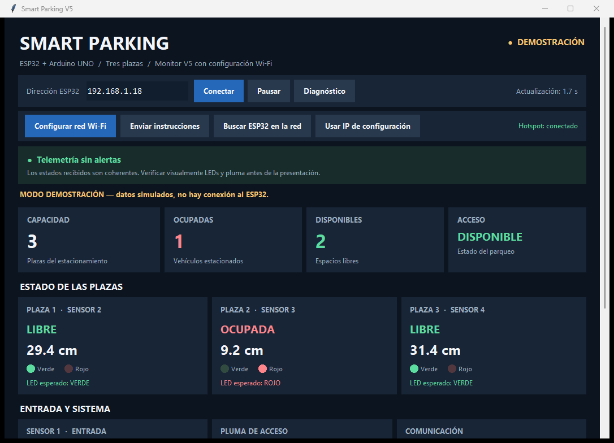
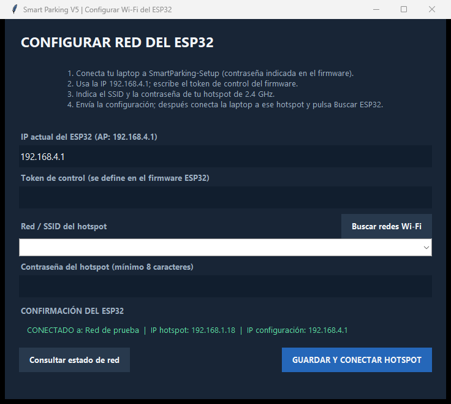
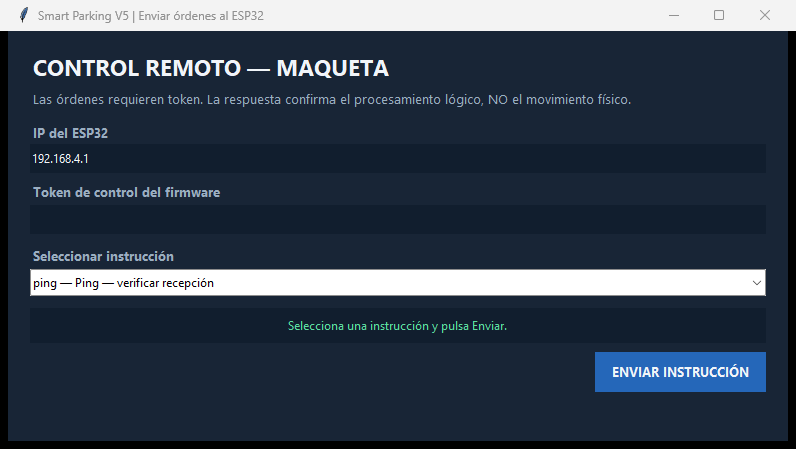

# 04 — Aplicación de escritorio Python

## Dependencias

| Uso | Requisitos |
|---|---|
| Abrir el ejecutable en Windows | Abre `SmartParkingMonitorV5.exe` desde la raíz del proyecto. |
| Ejecutar el código fuente | Python 3.10 o superior con Tcl/Tk. `requirements.txt` contiene cero paquetes de pip. |
| Ejecutar las pruebas | La misma instalación de Python. El servidor simulado se comunica con el monitor en la propia computadora. |
| Generar el ejecutable | Python para Windows, Tcl/Tk y PyInstaller 6.16.0, fijado en `requirements-dev.txt`. |

## Módulos del monitor y motivo de uso

Todos los módulos de esta tabla forman parte de la biblioteca estándar. Las funciones indicadas corresponden a [monitor_parqueo.py](../aplicacion/monitor_parqueo.py).

| Módulo | Uso concreto | Por qué se utiliza |
|---|---|---|
| `tkinter` | Ventana principal, botones, campos y gráficas de sensores con `Canvas`. | Proporciona una interfaz de escritorio y dibujo básico con Tcl/Tk. |
| `tkinter.ttk` | Listas desplegables para seleccionar red, ESP32 y orden. | Un `Combobox` permite elegir opciones válidas y editar el SSID cuando corresponde. |
| `tkinter.filedialog` | Selección de destino para CSV y reportes TXT. | Permite guardar las exportaciones en una carpeta elegida por el operador. |
| `tkinter.messagebox` | Avisos de red, errores y confirmaciones de apertura o cierre. | Presenta el resultado de la operación en la propia ventana. |
| `urllib.request` | `Request` y `build_opener` envían GET o POST con tiempo límite. `ProxyHandler({})` desactiva el proxy para estas consultas. | La aplicación se comunica directamente con el ESP32 en la LAN. |
| `urllib.parse` | `urlsplit` separa host y puerto. `urlencode` prepara los campos de los POST. | Facilita validar la dirección y codificar SSID, contraseñas y parámetros de órdenes. |
| `urllib.error` | Captura `HTTPError` y permite leer el cuerpo de una respuesta de error. | El monitor puede presentar detalles como una orden que el firmware devolvió con HTTP 409. |
| `json` | Lee los objetos de telemetría, procesa respuestas de configuración y guarda el último host. | Usa el mismo formato de intercambio que la API del ESP32 y un formato legible para el ajuste local. |
| `socket` | Identifica las direcciones IPv4 de la computadora y resuelve su nombre local. | La búsqueda del ESP32 parte de las redes que la computadora tiene disponibles. |
| `ipaddress` | Valida direcciones, filtra interfaces y enumera hosts de una red `/24`. | Delimita las direcciones candidatas al segmento local que examina el monitor. |
| `re` | Comprueba la sintaxis del nombre del ESP32. | Restringe los nombres ingresados a letras, números, puntos y guiones. |
| `concurrent.futures` | `ThreadPoolExecutor` prueba IP candidatas en paralelo y `as_completed` recoge sus resultados. | Reduce el tiempo de descubrimiento cuando algunas direcciones agotan su tiempo de espera. |
| `threading` | Ejecuta consultas y acciones de red en hilos de trabajo. | Permite que la ventana siga respondiendo mientras el monitor espera una respuesta. |
| `queue` | `Queue` entrega resultados y errores de los hilos al bucle de Tkinter. | Mantiene las actualizaciones de los controles gráficos en el hilo de la interfaz. |
| `collections` | `deque` conserva hasta 1,800 muestras y 350 eventos en memoria. | Limita el espacio ocupado y descarta las entradas más antiguas al superar el máximo. |
| `csv` | Produce una tabla con marcas de tiempo, distancias, ocupación y estado del equipo. | Facilita abrir el historial en una hoja de cálculo. |
| `datetime` | Fecha los eventos, las filas del historial y los archivos exportados. | Permite ordenar muestras y asociarlas con una hora de captura. |
| `time` | `monotonic()` calcula el tiempo transcurrido para el modo demostración. | La simulación usa un reloj de intervalos que sigue avanzando si cambia la hora del sistema. |
| `math` | `isfinite()` valida distancias y señal. `ceil()` calcula la escala vertical de la gráfica. | Mantiene valores numéricos inválidos fuera de los indicadores y de la gráfica. |
| `pathlib` | Maneja rutas, directorios, archivos de preferencias y reportes. | Facilita leer y escribir archivos en las carpetas del sistema y del usuario. |
| `os` | Consulta la variable de entorno `APPDATA` en Windows. | Ubica el archivo con el último host en la carpeta de datos del usuario. |
| `uuid` | Genera el identificador corto incluido en cada orden enviada. | Permite comparar el identificador enviado con el que devuelve el ESP32 en su acuse. |
| `argparse` | Procesa `--demo` y `--host`. | Permite seleccionar el modo de inicio o fijar el ESP32 desde la terminal. |

## Módulos de pruebas y validación

| Módulo | Uso |
|---|---|
| `unittest` | Ejecuta los 17 casos del monitor y los 9 casos de red. |
| `http.server` | `ThreadingHTTPServer` y `BaseHTTPRequestHandler` simulan respuestas HTTP del ESP32 sin usar la maqueta. |
| `tempfile` | Crea directorios temporales para comprobar archivos de configuración y CSV. |
| `urllib.parse` | `parse_qs` interpreta el cuerpo de las solicitudes simuladas. |
| `threading` y `json` | Mantienen la API de prueba en segundo plano y codifican sus respuestas. |
| `csv`, `datetime` y `pathlib` | Comprueban las columnas, las fechas y los archivos exportados. |
| `pathlib` y `re` | En `herramientas/validar_repositorio.py`, leen los archivos del proyecto y comprueban pinout, formatos y configuración. |

## Pantallas







- **Resumen**: capacidad 3, ocupadas, disponibles, acceso.
- **Tres plazas**: distancia, estado libre/ocupado/desconocido, LED lógicos.
- **Entrada y sistema**: S1, pluma, Arduino UNO, señal RSSI y uptime.
- **Conectividad**: dirección actual, `192.168.4.1`, búsqueda del ESP32.
- **Wi-Fi**: escanear SSID, registrar contraseña del hotspot, guardar y consultar estado STA.
- **Órdenes**: `ping`, test de LED y apertura/cierre sujetos a validación del ESP32.
- **Herramientas**: eventos, diagnósticos TXT, historial CSV y modo demostración.

## Ejecutar en Windows

Desde PowerShell en la raíz del proyecto, comprueba que la instalación de Python puede abrir una ventana de Tcl/Tk:

```powershell
py -3 -m tkinter
```

Cierra la ventana de prueba y elige uno de estos modos:

```powershell
# Monitor conectado al ESP32
py -3 aplicacion/monitor_parqueo.py --host 192.168.4.1

# Demostración con sensores simulados
py -3 aplicacion/monitor_parqueo.py --demo
```

En Windows puedes ejecutar `aplicacion/ABRIR_MONITOR.cmd` o `aplicacion/ABRIR_DEMO.cmd`. Consulta la [documentación de Tkinter](https://docs.python.org/3/library/tkinter.html) para verificar Tcl/Tk.

## Generar el ejecutable

Abre `aplicacion/CREAR_EJECUTABLE.cmd` en Windows. El script instala PyInstaller con `requirements-dev.txt`, agrupa el intérprete, Tcl/Tk y los módulos usados por la app en un solo `.exe`, y copia el resultado al Escritorio. El modo `--windowed` permite abrir el panel sin una consola de Python. Consulta [cómo empaqueta PyInstaller](https://www.pyinstaller.org/en/stable/operating-mode.html).

## Tratamiento de fallos

- `null` en distancia y ocupación = desconocido, **jamás libre**.
- Si falla UNO, se ocultan mediciones y conteos obsoletos.
- Si falla HTTP, UI indica desconexión y reintenta.
- Si `/api/logs` falla pero `/api/estado` funciona, conserva telemetría con aviso específico.
- Cambio de Wi-Fi: primero se recibe la configuración (`202 Accepted`), luego se consulta `/api/wifi/status` para confirmar asociación real e IP asignada.
- La única preferencia guardada por la app es la última IP/hostname (Windows: `%APPDATA%/SmartParkingMonitor/config.json`). **No almacena la contraseña ni el token**.

## Restricciones conocidas

El descubrimiento de red revisa la subred `/24` accesible, no todos los segmentos de la red; puede fallar si el hotspot aísla clientes o utiliza otra máscara. El LED en pantalla es estado previsto y la pluma es ordenada por firmware. El historial se conserva en memoria y debes exportarlo antes de cerrar el programa.
